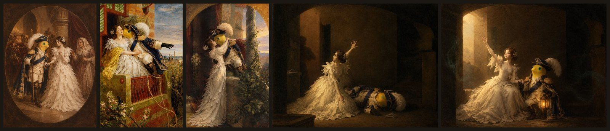

# nai · VibeHacks #06 参赛作品

> **接手的 AI 请先读 [HANDOFF.md](HANDOFF.md)。** 它每一轮都会更新，写着现状、待决定的事和下一步。

> VibeHacks #06「Vibe Coding for 3D 游戏世界」参赛作品。两人参赛，代码全部由 AI（Kiro，模型 Claude Opus 5.5）编写，我们负责想法、试玩、反馈和决策。

## 我们在做什么游戏（10-31 02:15 定，每次改方向都更新这一节）

**一句话：** 一局 3 分钟，边打怪边把《罗密欧与朱丽叶》从舞会演到墓室；每打完一幕，画面定格成一幅真实的欧洲名画；最后一幕守住沉睡的朱丽叶，就能改写莎士比亚的结局。

**怎么玩：** 手机横屏，双摇杆。左手按住拖动是走，右手拖动是瞄准；右手不碰时自动打最近的怪。罗密欧用情歌打怪，射出去的是发光的音符。怪越来越多，打死的怪变成萤火，捡起来升级；每次升级从三个技能里选一个（比如一次射出更多音符、往身后也射、音符能穿透），选完以自己为中心震开一圈。开局很简单，一波一波变难，越到后面技能选错越容易死。

**一局的四幕**（10-31 02:40 起，名画用我们自己重画的油画：照原作的构图，把人物换成我们的角色，见下图）
| 幕 | 剧情 | 打什么 | 打完定格成的画（致敬哪幅原作） |
|---|---|---|---|
| 一 舞会 | 卡普莱特家的假面舞会，罗密欧第一次见到朱丽叶 | 被仇恨附身的乐器怪、戴鸟嘴面具的客人 | 致敬《罗密欧与朱丽叶在假面舞会上》：威廉·汉密尔顿画、弗朗切斯科·巴尔托洛齐刻的版画，1785 年，美国大都会艺术博物馆藏。我们的版本里，背后盯着罗密欧的是提伯尔特 |
| 二 阳台 | 夜里翻进花园，两人在阳台下定情 | 巡夜的家丁、看门的三头大狗 | 致敬福特·马多克斯·布朗《罗密欧与朱丽叶》，1870 年，美国特拉华艺术博物馆藏 |
| 三 决斗 | 提伯尔特杀了茂丘西奥，罗密欧为朋友报仇，被放逐，天亮前在阳台上和朱丽叶告别 | 两大家族的人潮，最后是提伯尔特 | 致敬弗兰克·迪克西《罗密欧与朱丽叶》，1884 年，英国南安普敦市立美术馆藏 |
| 四 墓室 | 朱丽叶喝了假死药躺在墓室里 | 守住她直到她醒来，亡魂从四面涌来 | 守住了：改写的结局，用同一种画风画两人都活着。没守住：原版结局，致敬德比的赖特《罗密欧与朱丽叶：墓室》，1790 年，英国德比博物馆与美术馆藏 |

- 每幕打完：画面定格，镜头拉起，我们重画的油画浮现，旁边写原作的画名、画家、年份、收藏地，再加两三句小知识。中途死了也会给一条。
- 四个场地的场景图（给网页版和 Unity 用）见 [Unity 场景和提示词](docs/Unity场景和提示词.md)。
- 幕和幕之间两三句对白；打的时候角色头上也会冒一句话。
- **角色：** 黄色圆头角色 = 罗密欧（玩家），婚纱公主 = 朱丽叶，牛头人 = 提伯尔特（第三幕 Boss），兔子头人 = 茂丘西奥（罗密欧的朋友）。
- **怪：** 鼓、鲁特琴、号角三只乐器怪（舞会上被附身的乐队）、鸟头怪（鸟嘴面具的客人）、三头犬（卡普莱特家看门的大狗）、亡魂（墓室）。
- **画面：** 3D 动画电影质感的欧洲童话，烛光暖金、阴影冷蓝，见 [美术风格](docs/美术风格.md)。完整方案见 [故事方案：罗密欧与朱丽叶 × 名画](docs/故事方案-罗密欧与朱丽叶.md)。

**现在做到哪：** 线上还是 v0.1 测试版；正式游戏的第一版（第一幕能完整玩）正在写。

## 项目信息
- **试玩网址：** https://historycrew5423-art.github.io/nai/ （手机横屏打开）
- **分工：** 队长负责想法、试玩和决策；队友负责场景（`scene` 分支，`assets/scene/` 文件夹）；游戏代码由 AI 编写；队长用 Codex 在 Unity 里做预告片和过场视频（`unity` 分支）。
- **比赛开始时间：** 仓库建于 2026-10-30 19:46（上海时间）。第一个提交是 GitHub 建仓库时自动生成的，晚于 10-30 18:00 的线上启动会。
- **开发分支：** 所有开发都在 `dev` 分支上进行，`main` 留到最后合并。

## 过程记录
- [开发日志](docs/开发日志.md)：每一步做了什么、试玩反馈是什么、怎么改的。
- [对话原文](docs/对话原文/)：我们和 AI 每一轮对话的原文。AI 在后台执行的操作只写摘要。
- 比赛前的准备资料（规则、赞助工具、调研、试验）在知识库仓库 [3d-](https://github.com/historycrew5423-art/3d-/tree/handoff-pack)。那里的试验代码不会搬进本仓库，本仓库的游戏代码从零写。
- 方向的变化：多角色打怪射击（10-30 19:33）→ 俄耳甫斯下冥界（10-30 21:10）→ 罗密欧与朱丽叶 × 名画（10-31 02:15）。打法一直没变。

## 工具
- `tools/setup.sh`：在 Kiro Web 沙盒里装好无界面浏览器、three.js 和中文字体（装在仓库外的 `.tools`）。
- `tools/shot.sh`：用无界面浏览器打开本地网页并截图，打印报错和帧数，让 AI 自己检查画面。
- `tools/stress.mjs`、`tools/live.mjs`：压力测试、检查线上网址。
- `tools/process-models.mjs`：把 Tripo 原始模型处理成手机能用的版本。
- `tools/gen-image.mjs`：用 GPT-image-2.5 出参考图（只用每张 0.3 积分的模型，密钥不进仓库）；`tools/contact-sheet.mjs`：把几张图拼成一张小图。

## 素材和许可
- three.js r187（MIT），放在 `vendor/three/`。
- 角色模型：用户用 Tripo 生成（`assets/models/`）。参考图：用户和 AI 用出图工具生成（`assets/ref/`，AI 出的图记在 `assets/ref/生成记录.md`）。
- 名画：游戏里放的是 GPT-image-2.5 重画的油画（`assets/paintings/`），构图来自四幅公有领域的原作，原作的出处见 [assets/ref/originals/README.md](assets/ref/originals/README.md)。原作图只当出图参考，游戏里不用。
