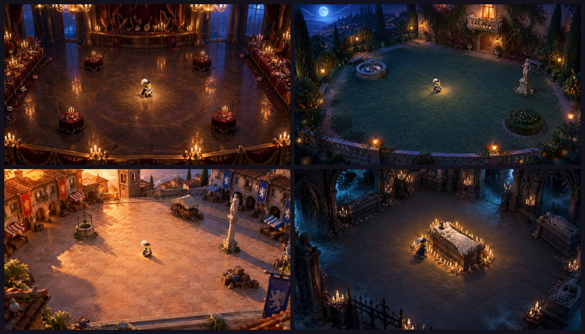

# Unity 场景：四张场景图、做游戏一般怎么用 Unity、给 Codex 的提示词（10-31 02:45）

> 用户（02:25）："你也出一个合适的3d场景图，我试一下用unity，你也查一下做游戏的一般怎么用unity"
> 用户（02:35）："可以用gptimage2.5做几个好的美术风格的游戏场景图，并想好提示词让我给codex的unity试试"

## 〇、一段话版：直接贴给 Codex，让它在 Unity 里搭场景（10-31 03:15）

> 用户（03:10）："给我可以直接让gpt用unity搭场景的提示词，要包括仓库链接那种，只搭场景不加人先"
> 用法：在 Mac 上新开一个 Codex 会话，整段贴进去。它会自己把仓库克隆下来，读这份文件第四节的「提示词 2 到 5」拿到每一幕的细节。已经开着的 Codex 会话也可以贴，开头写明了"这次只做一件事"。

```text
你是我在 VibeHacks #06 黑客松（主题「Vibe Coding for 3D 游戏世界」）的 Unity 搭档。我不会写代码，所有操作由你来做；需要我在界面上点的地方，一步一步告诉我。

【这次只做一件事】
在 Unity 里搭四个游戏场地，导出成 GLB，给我们的手机网页游戏用，以后也拿来拍过场视频。只搭场景，不放任何人物、怪物、动物。

【仓库】
- GitHub：https://github.com/historycrew5423-art/nai （公开仓库，开发分支是 dev）
- 克隆并新建 unity 分支：
  git clone https://github.com/historycrew5423-art/nai.git
  cd nai
  git checkout -b unity origin/dev
  （如果远端已经有 unity 分支，就改成 git checkout unity && git pull）
- 只在 unity/ 文件夹里新建和修改文件，不要改 unity/ 以外的任何文件（网页游戏的代码由另一个 AI 负责）。
- 推送前先确认 git push 能用。不能用就带我做 gh auth login（在网页上登录 GitHub）。不要让我把密码或密钥贴给你，也不要把任何密钥写进文件。

【先读这些（都在仓库里）】
1. docs/Unity场景和提示词.md：第四节的「提示词 1」是共同规矩，「提示词 2 到 5」是四幕各自的地面、四周、障碍物坐标和灯光。照那里的数字做。
2. 四张概念图，先打开看：assets/ref/scene-1-ballroom.png（舞会大厅）、scene-2-garden.png（花园阳台）、scene-3-piazza.png（维罗纳广场）、scene-4-tomb.png（墓室）。图里站着的小角色和墓室石台上的人，这次都不要做。
3. docs/美术风格.md：颜色表、光、「游戏画面要看得清」那一节。
4. docs/场景规格.md：尺寸、碰撞体、面数。

【最重要的规矩（和仓库文档有冲突时，以这里为准）】
- 不放任何人物：不要导入 assets/models/ 里的角色；第四幕中间的石台空着。看比例可以放一个 1.7 米高的灰色胶囊体，命名 SCALE_REF，导出前删掉。
- 单位米，Y 朝上，原点是场地中心，地面高度 0。可玩区域 60×60 米（X、Z 都从 -30 到 30），地面完全平整；中间 16×16 米空着。
- 障碍物 6 到 12 个：每个占地 1 到 4 米，高不超过 2.5 米，彼此至少隔 6 米，离边界至少 4 米。每个配一个碰撞体：方块命名 COL_BOX_01、COL_BOX_02……（只能绕 Y 轴转），竖直圆柱命名 COL_CYL_01……
- 可玩区域外面做一圈约 15 米宽的装饰，看得见、走不进。+Z 是镜头那一侧（概念图的下边），那一侧的装饰不高于 1 米。
- 游戏镜头：放一个相机 GameCam，位置 (0, 18, 13)，看向 (0, 0, 0)，竖直视角 45 度，画面 16:9。
- 地面中等偏暗、对比低、花纹少，上面要能看清几百只小怪和发光的子弹。精致的东西放在边上。
- 只用 URP/Lit 材质，只用 Base Map（颜色贴图），不用 Shader Graph 和自定义着色器（导出 GLB 时带不过去）。
- 每个 GLB 不超过 80000 个三角面、6 MB；贴图边长不超过 1024（重复铺的地面可以 2048）。
- 免费素材只用 CC0 的（Poly Haven、ambientCG、Kenney、Quaternius），每个素材的名字、网址、许可证记进 unity/日志.md。要花钱或花点数的（包括 Unity AI 的 Generators、Asset Store 付费素材），先问我。

【环境】
1. 先检查这台 Mac：芯片、剩余磁盘空间、git、Codex 版本、有没有 Unity Hub。把结果告诉我。
2. 用 Unity Hub 装 Unity 6.3 LTS（版本号 6000.3 开头）。新建项目选 Universal 3D（URP）模板，放在 nai/unity/VeronaArenas。下载很慢或失败就告诉我，可以改用团结引擎。
3. 装 Unity 官方的 Codex 插件：
   codex plugin marketplace add Unity-Technologies/unity-agent-plugin
   codex plugin add unity@unity-agent-plugin
   用 codex plugin list 确认已安装、已启用。插件需要 Unity CLI 时按它的提示装。实在连不上编辑器也没关系：你直接写场景文件和编辑器脚本，让我在编辑器里点，再把截图给你看。
4. 在 Package Manager 里按名字添加 com.unity.cloud.gltfast（导出 GLB 用）。在 unity/VeronaArenas/ 放 Unity 的 .gitignore（排除 Library、Temp、Logs、obj、Build、UserSettings）。

【做法（每一步做完都停下来，给我截图，我说继续再往下）】
先只做第一幕舞会大厅。我看过满意了，再做第二、三、四幕。
1. 灰盒：用方块、圆柱、平面（或 ProBuilder）按尺寸搭地面、四周的大轮廓、障碍物和碰撞体。截图两张：GameCam 一张；把 GameCam 临时移到 (22, 18, 35) 看向 (22, 0, 22) 一张（场地角落）。
2. 美术：照概念图换材质、加道具、打灯光、加后期（Volume 里的 Bloom、调色、暗角），让 GameCam 的截图尽量像概念图。再放一个低机位的电影相机 FilmCam（高约 1.6 米，看向场地中间），截一张。
3. 导出：可玩区域、装饰、碰撞体都放在一个根物体 Arena_Act1（第二到四幕是 Arena_Act2、Arena_Act3、Arena_Act4）下面。选中它，用 GameObject > Export glTF > glTF-Binary 导出到 unity/output/scene/act1-ballroom.glb（之后是 act2-garden.glb、act3-piazza.glb、act4-tomb.glb）。灯光导不进 GLB，把主要灯光的类型、颜色、位置、方向、强度写进 unity/output/scene/灯光.md。截图存进 unity/output/screens/。
4. 告诉我三角面数、文件大小、用了哪些素材，然后提交并推送到 unity 分支。

【工作方式】
- 在 unity/日志.md 里按时间记每一步：做了什么、我的反馈、怎么改的。
- 每一幕最多花 60 分钟，到时间没做完就停下，把现状给我看。四幕最晚在上海时间 10 月 31 日 10:00 之前推送，网页版要接进去。
- 单个文件不超过 50 MB。改大东西之前先提交一次，出错能退回。

现在先做【环境】第 1 步，告诉我结果和接下来要我做什么。
```

## 一、四张场景图（GPT-image-2.5，每张 0.3 积分）



| 幕 | 文件 | 画的是什么 |
|---|---|---|
| 一 舞会 | [assets/ref/scene-1-ballroom.png](../assets/ref/scene-1-ballroom.png) | 卡普莱特家的舞会大厅：深色大理石地面、中间一圈很淡的花纹；远处是红丝绒帷幕、乐队台和被丢下的乐器、月光窗；左右是长餐桌；场地里只有四张小圆桌；近处是一排低矮的金色栏杆和蜡烛 |
| 二 阳台 | [assets/ref/scene-2-garden.png](../assets/ref/scene-2-garden.png) | 月光下的花园：草地和浅色碎石小路；远处是亮着灯的别墅和朱丽叶的小阳台，爬满常春藤和玫瑰；左右是柏树、绿篱、橘子树和灯笼；场地里有喷泉、雕像、圆形绿篱；近处是低矮的石栏杆 |
| 三 决斗 | [assets/ref/scene-3-piazza.png](../assets/ref/scene-3-piazza.png) | 日落时的维罗纳广场：粉色和赭色的大石板；四周是红瓦房子、拱廊、钟楼和条纹棚子的小摊；左边挂卡普莱特家的红旗，右边挂蒙太古家的蓝旗；场地里有水井、马车、雕像柱、一堆木箱 |
| 四 墓室 | [assets/ref/scene-4-tomb.png](../assets/ref/scene-4-tomb.png) | 卡普莱特家的墓室：灰紫色石板地；正中间的石台上躺着沉睡的朱丽叶，四周一圈蜡烛；边上是石棺、尖拱、铁栅栏、烛台；四角有青色的雾漫进来 |

四张都是游戏镜头的角度（斜上方约 55 度往下看），中间留空给怪潮，精致的东西都在边上，靠镜头那一边很矮不挡视线，正好对上 [场景规格](场景规格.md)。主角站在正中间当比例尺。
提示词全文记在 [assets/ref/生成记录.md](../assets/ref/生成记录.md)。

## 二、做游戏的一般怎么用 Unity（给你看的，几分钟读完）

1. **装编辑器：** 用 Unity Hub 装 Unity 6.3 LTS（长期支持版，官方支持到 2027 年 12 月；最新的是 6.6，6.7 LTS 快出了）。新建项目选 **Universal 3D（URP）** 模板，手机和网页都靠它。
2. **先搭灰盒，再做美术：** 一般先用方块和圆柱（或 Unity 自带的 ProBuilder）按真实尺寸搭出场地，放上游戏镜头看：走得通吗、看得清吗、怪会不会卡住。布局定了，再换成好看的模型和材质。我们的四张场景图就是"换美术"那一步的目标。
3. **放素材：** 模型用 FBX 或 GLB（GLB 要装 glTFast 包），贴图做成材质。常用的免费素材：Poly Haven（贴图和天空，CC0 随便用）、Kenney 和 Quaternius（低面数模型，CC0）。Asset Store 的素材要先看许可证能不能放进公开仓库。
4. **灯光和后期：** 场景的气氛主要靠灯光。URP 里放主光、点光源，再加一个 Volume 做后期（Bloom 发光、调色、暗角）。不动的灯可以"烘焙"进贴图，画面好看又省性能。
5. **镜头：** Cinemachine 做跟随主角的镜头和镜头切换；过场动画用 Timeline，像剪视频一样排镜头、角色动作、灯光。
6. **动作：** 人形角色绑骨骼以后用 Animator 播放动作（可以用 Mixamo 的现成动作）。我们的模型没有骨骼，就用 Timeline 关键帧或小脚本做弹跳、摇晃。
7. **出成品：** Unity Recorder 录 MP4 和截图；打包可以出 Web、iOS 等。我们不在 Unity 里打包游戏（理由见 [给 Codex 的方案](给Codex的方案.md) 第二节）。
8. **版本管理：** 用 git，加 Unity 的 `.gitignore`（Library、Temp 这些不传）。改大的东西之前先提交一次，出错能退回。
9. **AI 怎么接进来（2026 年的做法）：**
   - **Codex + Unity 官方插件**（`Unity-Technologies/unity-agent-plugin`，现在是 0.1.8-beta，支持 Unity 6 以上）。插件里有建项目、URP 后期、物理碰撞、包管理等技能，通过 Unity CLI 直接操作你打开的编辑器：建物体、改设置、运行 C# 再检查结果。官方提醒：它会直接改项目，不是每一步都能撤销，所以先提交再让它做大改动。装法已经写在 [给 Codex 的方案](给Codex的方案.md) 第三节。
   - **Unity AI**（编辑器自带，2026 年 5 月起对 Unity 6 公测）：Assistant 能用一句话搭场景、写脚本；Generators 能生成占位的材质、声音、3D 模型。要用 Unity 的点数，**花钱的东西先问用户**。

**我们这次 Unity 做两件事：**
1. 原来的：预告片、四段过场视频、截图（见 [给 Codex 的方案](给Codex的方案.md)）。
2. **新的、可选：** 按这四张图在 Unity 里搭四个场地，导出成 GLB，Kiro 放进网页游戏。搭得顺就用 Unity 的；不顺也没关系，Kiro 会在网页里照这四张图自己搭简化版。过场视频也可以直接用这些场地。

## 三、这些提示词怎么用
- 先把仓库拉到最新（`git pull`），四张场景图就在 Mac 上的 `assets/ref/` 里。把图拖进 Codex 的对话框，或者在提示词里写图的路径，让它自己打开看。
- **已经开着的 Codex 会话：** 先贴「提示词 1」，再贴想做的那一幕（建议先只做第一幕）。
- **新开的会话：** 先贴 [给 Codex 的方案](给Codex的方案.md) 第三节的完整提示词，再贴这里的。
- 每做完一步，Codex 会给截图。把截图发给 Kiro，Kiro 帮你看和概念图差在哪。

## 四、提示词（整段复制给 Codex）

### 提示词 1：搭场地的共同规矩（先贴一次）

```text
新任务：按概念图在 Unity 里搭四个游戏场地，导出 GLB 给我们的网页游戏用，同时也给过场视频用。先做第一幕，做完给我看，我说继续再做下一幕。

参考：
- 概念图：仓库里的 assets/ref/scene-1-ballroom.png、scene-2-garden.png、scene-3-piazza.png、scene-4-tomb.png。先打开看图。
- 美术风格：docs/美术风格.md（颜色表、光的规则、"游戏画面要看得清"那一节）。
- 场景规格：docs/场景规格.md。最重要的数字我抄在下面。

尺寸和坐标（网页游戏的代码按这个写，不能改）：
- 单位米，Y 轴朝上。原点是场地正中间，地面高度 0。
- 可玩区域：以原点为中心、边长 60 米的正方形（X、Z 都从 -30 到 30），地面完全平整。
- 中间 16×16 米留空（第四幕例外，见那一幕的说明）。
- 场地里放 6 到 12 个障碍物：每个占地 1 到 4 米，高不超过 2.5 米，彼此至少隔 6 米，离边界至少 4 米。我在每一幕里给了位置，可以微调，但要守住这些距离。
- 每个障碍物配一个碰撞体，是单独的物体：方块命名 COL_BOX_01、COL_BOX_02……（只能绕 Y 轴转），竖直圆柱命名 COL_CYL_01……。放在障碍物同一个位置。
- 可玩区域外围做一圈约 15 米宽的装饰（墙、树、房子、栏杆），看得见、走不进，不需要碰撞体。
- +Z 是镜头那一侧（概念图的下边）。那一侧的装饰不高于 1 米；-Z 是远处（概念图的上边），可以高。概念图的左边是 -X，右边是 +X。
- 游戏镜头：在主角上方 18 米、往 +Z 13 米的地方看向主角，竖直视角 45 度，16:9。网页版可能拉近一点，以这个为最远的情况。在场景里放一个这样的相机，命名 GameCam，看向原点。

做法，分三步，每步做完都停下来给我截图：
1. 灰盒：用方块、圆柱、平面（或 ProBuilder）按上面的尺寸搭地面、边界装饰的大轮廓、障碍物和碰撞体。截图：GameCam 看原点一张；把 GameCam 移到 (22, 18, 35) 看 (22, 0, 22) 一张（场地角落）。
2. 美术：照概念图换材质、加道具、打灯光和后期，让 GameCam 的截图尽量像概念图。规矩：
   - 地面中等偏暗、对比低、花纹少，上面要能看清几百只小怪和发光的子弹。精致的东西放边上。
   - 颜色用 docs/美术风格.md 的颜色表：大面积是暗色，暖金的烛光、冷蓝的阴影。
   - 只用 URP/Lit 材质，只用 Base Map（颜色贴图），不用 Shader Graph 和自定义着色器（导出 GLB 时带不过去）。
   - 免费素材只用 CC0 的（Poly Haven、Kenney、Quaternius），每个素材的名字、网址、许可证记进 unity/日志.md。要花钱或花点数的（包括 Unity AI Generators），先问我。
   - 截图：GameCam 一张；再放一个低机位的电影镜头（高 1.6 米左右，看向场地中间）一张，给过场视频用。
3. 导出：所有可玩区域、装饰和碰撞体放在一个根物体 Arena_Act1（Arena_Act2……）下面。选中它，用 glTFast 的 GameObject > Export glTF > glTF-Binary 导出到 unity/output/scene/act1-ballroom.glb（act2-garden.glb、act3-piazza.glb、act4-tomb.glb）。
   - 限制：整个文件不超过 80000 个三角面、6 MB；贴图边长不超过 1024（重复铺的地面可以 2048）。超了就减面、合并、缩贴图。
   - 灯光导不进网页版。把主要灯光的颜色、方向、位置、强度写进 unity/output/scene/灯光.md，网页版照着打灯。
   - 告诉我：三角面数、文件大小、用了哪些素材。

工作方式：照旧在 unity 分支、unity/ 文件夹里做，不改 unity/ 以外的文件。每步做完提交并推送，在 unity/日志.md 里记一笔。每一幕最多花 60 分钟；到时间没做完就停下，把现状给我看。
```

### 提示词 2：第一幕 舞会大厅

```text
做第一幕：卡普莱特家的假面舞会大厅，夜里。照 assets/ref/scene-1-ballroom.png。

- 地面：深梅子色偏棕的抛光大理石，中间有一圈很淡的大圆形花纹（直径约 20 米），反光弱一点，不能比怪亮。
- 远处（-Z，Z 约 -32 到 -40）：一面高墙，暗红丝绒帷幕、金色壁柱、高拱窗（窗外冷蓝月光），墙前是高出地面约 1 米的乐队台，上面放被丢下的竖琴、鲁特琴、鼓、号角。
- 左右两边（X 约 ±31 到 ±38）：长餐桌，铺暗红桌布，上面有金烛台、水果、酒壶、威尼斯面具；地上靠边的地方撒面具、丝带和红玫瑰花瓣（只在边上）。
- 近处（+Z，Z 约 31）：一排高约 0.8 米的金色矮栏杆，上面一排蜡烛。
- 天花板不用做，镜头看不到；只做几盏大吊灯在地面上投下暖色的光斑。
- 障碍物（8 个）：
  - 小圆桌 4 张，铺暗红桌布、桌上一个烛台：(-11, -11)、(11, -11)、(-11, 11)、(11, 11)，半径 1.2 米，高 0.8 米，COL_CYL。
  - 竖琴雕像 2 个：(-20, 0)、(20, 0)，半径 1 米，高 2.4 米，COL_CYL。
  - 落地大烛台 2 个：(0, -20)、(0, 20)，半径 0.6 米，高 2.2 米，COL_CYL。
- 灯光：吊灯的暖光 #ffb85c 照在地面中间，窗外进来的冷蓝月光 #9fb4ff，暗处是 #14121c 到 #22263a。
```

### 提示词 3：第二幕 花园和阳台

```text
做第二幕：卡普莱特家的花园和朱丽叶的阳台，夜里。照 assets/ref/scene-2-garden.png。

- 地面：深蓝绿色的草地，上面有浅色碎石小路，图案简单。
- 远处（-Z）：亮着暖灯的别墅墙，墙上二楼有一个小石头阳台（离地约 4 米，在 X=8 附近），爬满常春藤和红玫瑰，阳台后面的窗户发暖光。别墅后面是远处山坡上的维罗纳灯火和月亮（可以用天空盒或一张远景片）。
- 左右两边：高高的深色柏树、修剪过的绿篱、橘子树、石头花盆、挂着的灯笼，绿篱边有萤火虫（粒子，导出时不用带）。
- 近处（+Z）：一排高约 0.8 米的石头栏杆，栏杆柱上有小灯笼。
- 障碍物（7 个）：
  - 圆形石喷泉：(-12, -12)，半径 2 米，高 1.2 米，COL_CYL。
  - 雕像加底座：(14, -10)，半径 1 米，高 2.4 米，COL_CYL。
  - 圆形绿篱：(12, 13)，半径 2 米，高 1.5 米，COL_CYL。
  - 盆栽橘子树 4 棵：(-15, 12)、(0, -20)、(-22, 0)、(22, 2)，半径 0.8 米，高 2.4 米，COL_CYL。
- 灯光：整体是冷蓝的月光 #9fb4ff，窗户和灯笼是暖色 #ffb85c 的小光源，场地中间不要太黑，草地要能看清怪。
```

### 提示词 4：第三幕 维罗纳广场

```text
做第三幕：提伯尔特和罗密欧决斗的维罗纳广场，日落。照 assets/ref/scene-3-piazza.png。

- 地面：浅粉色和赭色的大块旧石板（维罗纳的粉色大理石），简单的方格铺法。注意比概念图暗一点、对比再低一点，怪要能看清。
- 四周（-Z 和左右）：红瓦屋顶的老房子，带拱廊和木百叶窗；远处一座砖砌的罗马式钟楼；条纹棚子的小摊、木箱、木桶。左边（-X）的房子挂红底金色的卡普莱特家旗子，右边（+X）挂蓝底银色的蒙太古家旗子。
- 近处（+Z）：一级低矮的石台阶，高不超过 0.5 米。
- 障碍物（7 个）：
  - 石井：(-13, -9)，半径 1.3 米，高 1.2 米，COL_CYL。
  - 带篷的木马车：(10, -14)，绕 Y 轴转 20 度，3 × 1.6 米，高 2 米，COL_BOX。
  - 雕像柱：(14, 6)，半径 0.9 米，高 2.5 米，COL_CYL。
  - 一堆木箱：(6, 16)，2.5 × 2.5 米，高 1.6 米，COL_BOX。
  - 小摊：(-20, 10)，3 × 2 米，高 2.4 米，COL_BOX。
  - 木桶 2 组：(-6, 20)、(22, -22)，半径 0.7 米，高 1 米，COL_CYL。
- 灯光：从左边（-X）低角度照过来的橙金色夕阳（约 #ffb070），长长的蓝紫色影子，天空是日落的渐变。
```

### 提示词 5：第四幕 墓室

```text
做第四幕：卡普莱特家的墓室，深夜。照 assets/ref/scene-4-tomb.png。

- 这一幕例外：场地正中间 (0, 0) 有一张低石台（2.6 × 1.4 米，高 0.9 米，长边沿 X 轴，COL_BOX）。概念图里朱丽叶躺在上面，但现在只搭场景，石台上先空着，不放任何人物（10-31 03:10 用户定的）。石台周围一圈蜡烛（半径约 2.5 米，装饰，不要碰撞体）。中间其余的地方照样留空。
- 地面：灰紫色的大块石板，素一点，有一点磨损。
- 四周：雕花石棺、哥特式尖拱和石柱、铁栅栏门、铁烛台上一排排滴着蜡的蜡烛、枯萎的花和褪色的红丝带。
- 近处（+Z）：低矮的铁栅栏，高不超过 1 米。
- 障碍物（8 个，不算中间的石台）：
  - 石棺 4 个：(-14, -14)、(14, -14)、(-14, 14)、(14, 14)，2.8 × 1.4 米，高 1 米，COL_BOX。
  - 石柱 4 根：(-22, 0)、(22, 0)、(0, -22)、(0, 22)，半径 0.8 米，高 2.5 米，COL_CYL。
- 灯光：中间那圈蜡烛是全画面最暖最亮的地方（#ffb85c）；其他地方是冷蓝和暗色；四角和拱门里有冷青色 #7fe3d8 的雾漫进来（雾和粒子只在 Unity 里用，导出时不用带）。
```

## 五、费用和来源
- 四张场景图共 1.2 积分，记在 [assets/ref/生成记录.md](../assets/ref/生成记录.md)。
- Unity 的资料来源：[Unity 6 版本和支持](https://unity.com/releases/unity-6-releases)、[Unity 2026 年的产品更新](https://unity.com/blog/unity-industry-product-releases-2026)、[Unity 官方 Codex 插件](https://github.com/Unity-Technologies/unity-agent-plugin)、[Unity AI 是什么](https://unity.com/resources/what-is-unity-ai)、[glTFast 在编辑器里导出](https://docs.unity3d.com/Packages/com.unity.cloud.gltfast@6.20/manual/ExportEditor.html)。内容是转述的。
